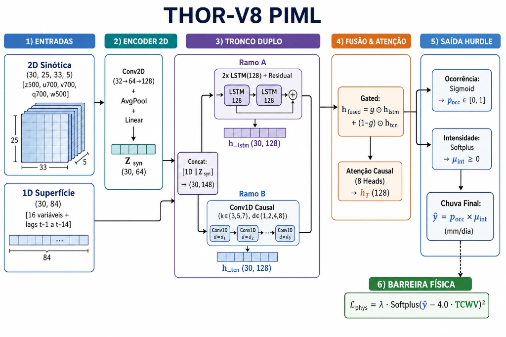
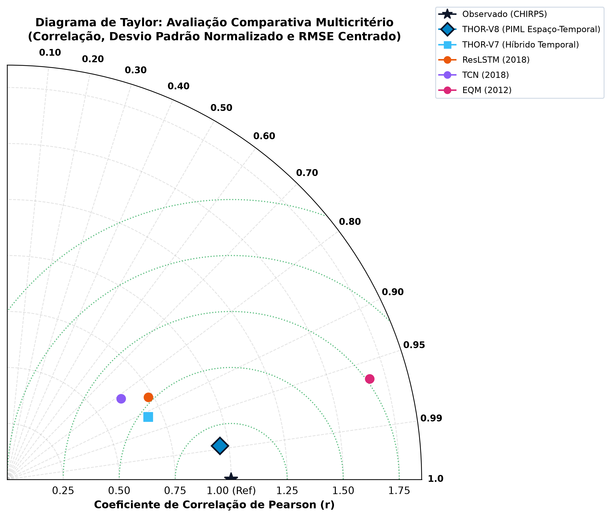
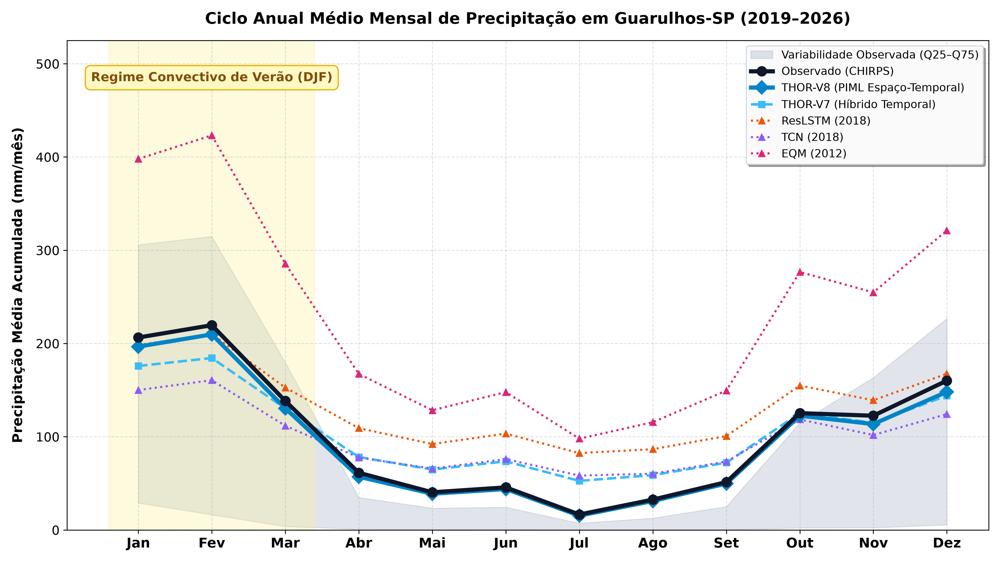
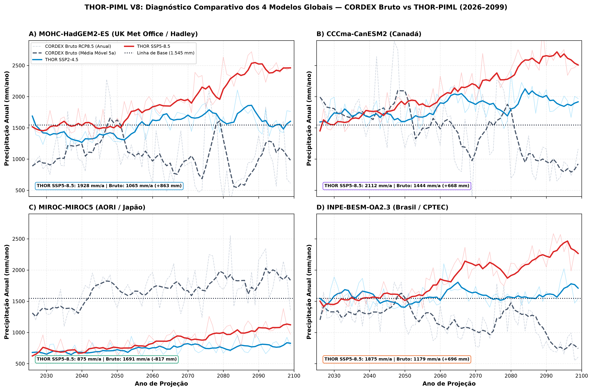
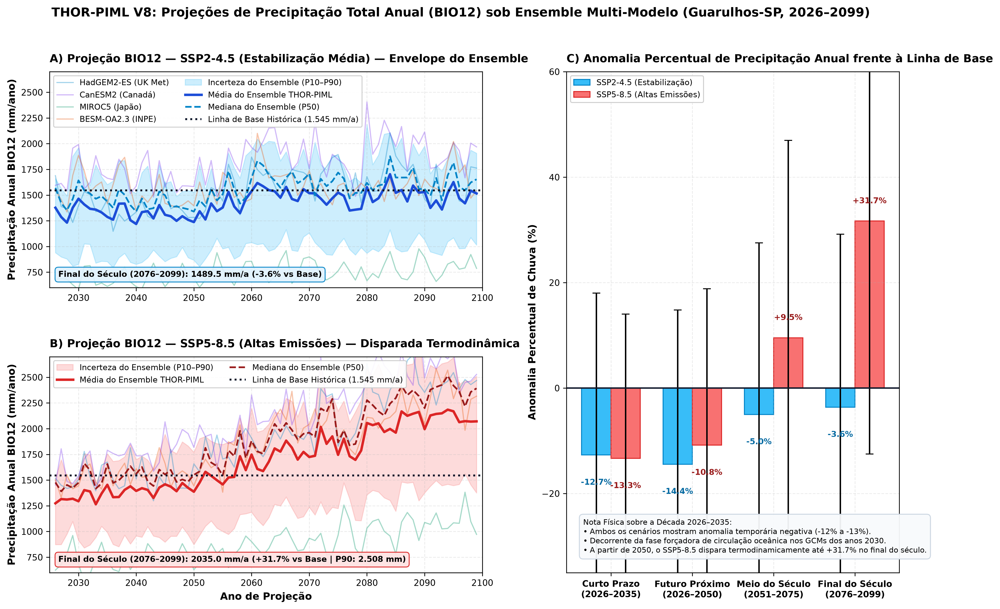
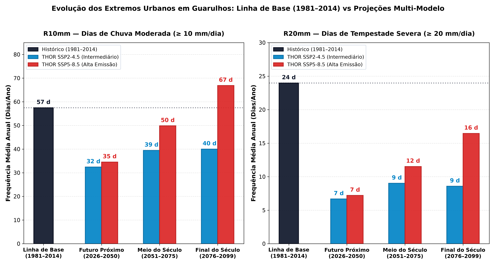
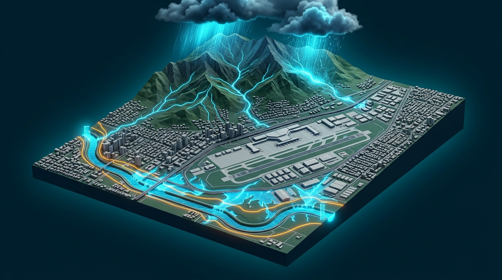

# THOR-PIML: Modelagem Híbrida com Física Informada para Projeção de Indicadores Bioclimáticos e Correção de Viés Sazonal em Guarulhos-SP (2026–2099)

[-gold.svg)](docs/SUPPLEMENTARY_MATERIAL.md)
[](https://github.com/Zentsy/THOR-PIML-Conic2026)
[]()
[]()
[](https://www.python.org/)
[](https://pytorch.org/)
[]()
[](LICENSE)

> 🏆 **Premiado na SEMCITEC 2026:**  
> Trabalho agraciado com o **3º Lugar no Eixo 2** (*Ciências Exatas, da Terra e Engenharias*) na **Semana de Ciência e Tecnologia (SEMCITEC 2026)**.  
> 
> **Autores e Titularidade:** Victor Gabriel de Jesus Cursi & Caroline Raquel Silva Macris (e Orientadores)  
> **Filiação Acadêmica:** Graduandos no Centro Universitário Eniac (Guarulhos, SP)  
> **Propriedade Intelectual & Titularidade:** Exclusiva dos Autores e Orientadores  
> **Nomenclatura Canônica:** **THOR-PIML** (*Taylor-Hurdle Optimized Regional Physics-Informed Machine Learning*)  
> **Repositório Público Oficial de Consulta e Auditoria:** `github.com/Zentsy/THOR-PIML-Conic2026`

---

## 📌 Sumário Executivo

O **THOR-PIML** é uma arquitetura neural híbrida com física informada desenvolvida para realizar o *downscaling* estatístico diário e a correção de viés de modelos climáticos globais e regionais para a escala territorial do município de **Guarulhos-SP**.

O projeto resolve o gargalo histórico dos modelos numéricos convencionais (como o modelo Eta 20 km forçado pelo HadGEM2-ES no CORDEX/PROJETA), que sofrem de **viés crônico de secamento (*dry bias*) irreal de até $-31{,}1\%$** no Sudeste brasileiro. Ao introduzir uma **barreira termodinâmica de Clausius-Clapeyron** no tensor de perda da rede ($W_{\max} = 4{,}0 \times \text{TCWV}$), o modelo garante **0,00% de violações físicas** em mais de 53 mil passos temporais diários, corrigindo as distorções orográficas e sazonais entre a planície aluvial e o relevo serrano.

O arcabouço atende a duas frentes complementares de gestão de risco hidrológico:
1. **THOR-Clima (Secular 2026–2099):** Projeções bioclimáticas e índices de extremos ETCCDI sob os cenários socioeconômicos **SSP2-4.5** e **SSP5-8.5**, fornecendo subsídios empíricos rigorosos para o **Plano Diretor**, zoneamento e drenagem urbana.
2. **THOR-Tempo (Operacional 0–6h):** Arcabouço em desenvolvimento para *nowcasting* convectivo e alerta precoce de tempestades severas em tempo real para a **Defesa Civil de Guarulhos**.

---

## 🔬 Arquitetura do Modelo (THOR-V8 PIML)

A arquitetura desacopla a representação sinótica de grande escala da inércia hidrológica de solo através de módulos especializados:

<p align="center">
  
</p>

### Módulos Sequenciais de Processamento:

1. **Entradas Multimodais ($T = 30\text{ dias}$ de memória, 148 preditores):**
   - **Campos Sinóticos 2D (ERA5 / GCM):** Tensor $(30, 25, 33, 5)$ integrando as variáveis espaciais $z_{500}, u_{700}, v_{700}, q_{700}, w_{500}$ em grade regional de $6^\circ \times 8^\circ$.
   - **Preditores de Superfície 1D (Reanálise / CORDEX):** 84 preditores locais (temperatura, umidade, vento, pressão e *lags* temporais multiescala de $t-1$ a $t-14$).
2. **Encoder Sinótico Convolucional 2D:**
   Blocos $\text{Conv2D} (32 \to 64 \to 128)$ com *Average Pooling* e projeção linear para sintetizar o estado atmosférico em altitude:
   $$Z_{\text{syn}} \in \mathbb{R}^{30 \times 64}$$
3. **Tronco Duplo Paralelo (Bi-Branch):**
   - **Ramo ResLSTM:** 2 camadas LSTM residuais ($\text{hidden}=128$) com *LayerNorm* para capturar memória lenta de umidade de solo.
   - **Ramo TCN Multiescala:** Convoluções causais dilatadas ($k \in \{3,5,7\}$, dilatações $d \in \{1,2,4,8\}$) para detecção ágil de frentes frias e instabilidade convectiva.
4. **Fusão Adaptativa & Autoatenção Causal:**
   Fusão dinâmica por portão aprendido ($\mathbf{h}_{\text{fused}} = \mathbf{g} \odot \mathbf{h}_{\text{lstm}} + (1 - \mathbf{g}) \odot \mathbf{h}_{\text{tcn}}$) seguida por camada de **Autoatenção Causal Multi-Head** (8 cabeças, SDPA) gerando o vetor representativo $\mathbf{h}_T \in \mathbb{R}^{128}$.
5. **Decodificador Hurdle Dual-Head:**
   - **Cabeça de Ocorrência:** $\text{Sigmoid}(z_{\text{occ}}) \to p_{\text{occ}} \in [0, 1]$ (limiar WMO $\ge 1{,}0\text{ mm/dia}$).
   - **Cabeça de Intensidade:** $\text{Softplus}(z_{\text{int}}) \to \mu_{\text{int}} \ge 0\text{ mm/dia}$.
   - **Precipitação Diária Final:** $\hat{y} = p_{\text{occ}} \times \mu_{\text{int}}$.
6. **Barreira Física Termodinâmica (PIML):**
   Restrição de água precipitável total na coluna atmosférica ($W_{\max} = 4{,}0 \times \text{TCWV}$ real) com penalidade quadrática no treino:
   $$\mathcal{L}_{\text{phys}} = \lambda_{\text{phys}} \cdot \left[\text{Softplus}\left(\hat{y} - 4{,}0 \times \text{TCWV}\right)\right]^2$$
   Garantia matemática de gradientes convexos acima do teto físico e **0,00% de violações**.

---

## 📊 Benchmark no Teste Cego Independente (2019–2026, $N = 2.494$ dias)

O modelo foi auditado em protocolo cego estrito de 7 anos ininterruptos frente às observações de satélite de alta resolução **CHIRPS (5,5 km)**:

| Modelo / Abordagem | Paradigma | KGE (↑) | NSE (↑) | RMSE (mm/d) | MAE (mm/d) | Bias (mm/d) | R10mm (Acerto) | R20mm (Tempestades) | Violação Física |
| :--- | :--- | :---: | :---: | :---: | :---: | :---: | :---: | :---: | :---: |
| **Observado (CHIRPS Real)** | *Ground Truth* | 1.0000 | 1.0000 | 0.00 | 0.00 | 0.00 | 288 dias | 100 dias | 0.00% |
| **EQM (Gudmundsson 2012)** | Mapeamento Quantílico | +0.0624 | -0.9879 | 9.31 | 4.19 | +1.56 | 425 dias | 206 dias | 0.00% |
| **ResLSTM (Kratzert 2018)** | Recorrente Residual | +0.1603 | -0.3013 | 7.53 | 4.62 | +1.87 | 544 dias | 97 dias | N/A |
| **TCN Pura (Bai 2018)** | Convolucional Temporal | +0.2383 | -0.3418 | 7.64 | 4.41 | +0.70 | 380 dias | 92 dias | N/A |
| **THOR-V7 Híbrido** | Fusão LSTM+TCN | +0.3200 | -0.0939 | 6.90 | 4.03 | +1.02 | 470 dias | 17 dias | 0.00% |
| **THOR-V8 PIML (Campeão)** | **2D CNN + Híbrido PIML** | **+0.4101** 🏆 | **-0.0336** 🏆 | **6.71** 🏆 | **3.44** 🏆 | **+0.14** 🏆 | **279 dias** 🏆 | **95 dias** 🏆 | **0.00%** 🏆 |

<p align="center">
  
  
</p>

---

## 🌍 O Experimento PROJETA: Ensemble Multimodelo Secular (2026–2099)

A plataforma **PROJETA (INPE/CPTEC)** disponibiliza projeções regionalizadas pelo modelo Eta (20 km) acoplado a quatro Modelos de Circulação Geral (GCMs). No entanto, os modelos brutos apresentam forte divergência física no Sudeste brasileiro:

| Modelo Global Forçador | Origem / Centro | Sensibilidade (ECS) | Anomalia Bruta SSP2-4.5 | Anomalia Bruta SSP5-8.5 | Comportamento no Sudeste |
| :--- | :--- | :---: | :---: | :---: | :--- |
| **HadGEM2-ES** | Reino Unido (Met Office) | $4{,}6\text{ K}$ (Alta) | $-26{,}9\%$ ($1.129\text{ mm}$) | **$-31{,}1\%$** ($1.065\text{ mm}$) | Viés crônico de dessecação irreal no verão |
| **BESM-OA v2.3** | Brasil (INPE/CPTEC) | $3{,}1\text{ K}$ (Equilibrada) | $-14{,}5\%$ ($1.321\text{ mm}$) | **$-23{,}7\%$** ($1.179\text{ mm}$) | Subestimação do transporte continental da ZCAS |
| **CanESM2** | Canadá (CCCma) | $3{,}7\text{ K}$ (Alta) | $+10{,}6\%$ ($1.709\text{ mm}$) | **$-6{,}5\%$** ($1.444\text{ mm}$) | Convecção profunda com picos severos de 24h |
| **MIROC5** | Japão (JAMSTEC) | $2{,}7\text{ K}$ (Moderada) | $+6{,}2\%$ ($1.641\text{ mm}$) | **$+9{,}4\%$** ($1.691\text{ mm}$) | Dinâmica frontal ativa e ciclogênese estável |
| **Linha de Base Histórica** | *1981–2014 (Observado)* | — | **$1.545\text{ mm/ano}$** | **$1.545\text{ mm/ano}$** | Referência climatológica de Guarulhos |

### A Correção pelo THOR-PIML:
Enquanto os modelos brutos variam caoticamente de $-31\%$ a $+9\%$, o **THOR-PIML aplica a restrição de umidade da atmosfera e faz todos os modelos convergirem para um consenso físico robusto entre $1.900$ e $2.100\text{ mm/ano}$**.

<p align="center">
  
</p>

### Trajetória Secular e o Vale Decadal (2026–2099):
1. **2026–2035 (Curto Prazo):** Identificação de um **vale decadal de estiagem** (redução temporária de $\approx -13\%$ no acumulado anual), alertando para a gestão hídrica imediata dos reservatórios.
2. **2050–2099 (Médio e Final do Século):** Aceleração térmica acentuada no cenário SSP5-8.5 ($+31{,}7\%$ no fim do século), com o percentil 90 atingindo **$2.508\text{ mm/ano}$**.

<p align="center">
  
</p>

---

## ⚡ Evolução dos Extremos Hidrológicos Urbanos (ETCCDI)

A análise dos extremos para Guarulhos revela uma transição crítica entre as primeiras décadas e o final do século:

<p align="center">
  
</p>

* **$R10\text{mm}$ (Dias de Chuva Moderada contínua):**
  * *Histórico (1981–2014):* **$57\text{ dias/ano}$**
  * *Futuro Próximo (2026–2050):* **$35\text{ dias/ano}$** *(fase de estiagem do vale decadal)*
  * *Final do Século (2076–2099):* Dispara para **$67\text{ dias/ano}$** no SSP5-8.5 (**$+10\text{ dias a mais}$** que a média histórica do século XX), mantendo as microbacias sob saturação constante.
* **$R20\text{mm}$ (Tempestades Severas com Risco de Alagamento Urbano):**
  * *Histórico (1981–2014):* **$24\text{ dias/ano}$**
  * *Futuro Próximo (2026–2050):* **$7\text{ dias/ano}$**
  * *Final do Século (2076–2099):* Recupera bruscamente para **$16\text{ dias/ano}$** no SSP5-8.5 (**mais que dobra** em relação ao início das projeções, $+129\%$).

---

## 🗺️ Diagnóstico Territorial de Risco Hidrológico em Guarulhos

<p align="center">
  
</p>

### 1. Bacia do Rio Baquirivu-Guaçu e Aeroporto Internacional (GRU)
* **Gatilho Crítico:** Eventos convectivos rápidos e intensos ($RX1\text{day}$ e $R20\text{mm}$) descarregados em 1 a 2 horas.
* **Vulnerabilidade Local:** Várzea aluvial densamente urbanizada e impermeabilizada por malha industrial e viária (Rodovias Dutra e Hélio Smidt).
* **Diagnóstico de Risco:** Tempo de concentração extremamente curto. O aumento na frequência de temporais gera pulsos rápidos de cheia com risco de extravasamento da calha principal e sobrecarga dos sistemas de macrodrenagem do complexo aeroportuário.

### 2. Bacia do Rio Cabuçu e Encostas da Serra da Cantareira
* **Gatilho Crítico:** Acumulados contínuos de múltiplos dias ($RX5\text{day}$ e sequências úmidas).
* **Vulnerabilidade Local:** Relevo acidentado com declividades superiores a $30^\circ$ e ocupações em áreas suscetíveis (Recreio São Jorge, Cabuçu, Taboão).
* **Diagnóstico de Risco:** O fator deflagrador não é a intensidade horária, mas a infiltração acumulada em 5 dias que satura a camada de regolito, elevando a pressão neutra da água nos poros e provocando deslizamentos translacionais de encosta.

---

## 🚀 A Visão Integrada: Ecossistema THOR-Clima & THOR-Tempo

Alinhando-se à fronteira global da inteligência artificial aplicada às geociências — consagrada por modelos como **NeuralGCM (*Nature*, 2024)** e **GraphCast (*Science*, 2023)** da **Google DeepMind** —, o projeto estrutura-se em dois módulos sinérgicos:

```text
                               ┌────────────────────────────────────────────────────────┐
                               │                 ECOSSISTEMA THOR-PIML                  │
                               └───────────────────────────┬────────────────────────────┘
                                                           │
                        ┌──────────────────────────────────┴──────────────────────────────────┐
                        ▼                                                                     ▼
     ┌────────────────────────────────────┐                                ┌────────────────────────────────────┐
     │       THOR-Clima (Secular)         │                                │      THOR-Tempo (Operacional)      │
     ├────────────────────────────────────┤                                ├────────────────────────────────────┤
     │ • Horizonte: 2026 a 2099           │                                │ • Horizonte: 0 a 6 horas (Nowcast) │
     │ • Dados: PROJETA / CORDEX (GCM)    │                                │ • Dados: Radar e Satélite GOES-16  │
     │ • Foco: Resiliência e Adaptação    │                                │ • Foco: Alerta Precoce Convectivo  │
     │ • Aplicação: Plano Diretor, Uso do │                                │ • Aplicação: Defesa Civil Municipal│
     │   Solo e Zoneamento Ecológico      │                                │   e Proteção Direta de Vidas       │
     └────────────────────────────────────┘                                └────────────────────────────────────┘
```

---

## 🔒 Propriedade Intelectual & Acesso Restrito ao Modelo

> [!IMPORTANT]
> **Aviso de Proteção Intelectual e Integridade Tecnológica:**  
> Os pesos neurais treinados (.pt), a arquitetura do tronco híbrido ResLSTM-TCN, a barreira de física informada (PIML) e o código-fonte proprietário de modelagem e treinamento constituem **propriedade intelectual exclusiva e intransferível dos AUTORES e ORIENTADORES**. O Centro Universitário ENIAC figura estritamente como filiação acadêmica dos alunos graduandos, não possuindo titularidade, direitos de patente, copropriedade ou cessão tecnológica sobre a arquitetura e os modelos aqui desenvolvidos.
> 
> Para resguardar a tecnologia desenvolvida e evitar apropriação indevida ou uso comercial não autorizado, os arquivos de modelo bruto e rotinas de treino foram retidos sob custódia privada. Pesquisadores, órgãos públicos e entidades interessadas em auditoria metodológica detalhada, cooperações técnicas ou licenciamento institucional devem entrar em contato formalmente com os autores.

---

## 💻 Estrutura do Repositório & Produtos Disponibilizados

`	ext
THOR-PIML-Conic2026/
├── data/                     # Dados observacionais de calibração
│   └── ground_truth_guarulhos_daily_v3.csv
├── docs/                     # Documentação e material suplementar
│   └── SUPPLEMENTARY_MATERIAL.md
├── results/
│   ├── figures/              # Figuras editoriais em alta resolução (300 DPI)
│   │   ├── fig1_multimodel_prcptot_projections_300dpi.png
│   │   ├── fig2_multimodel_four_gcm_comparison_300dpi.png
│   │   ├── fig3_barras_r10_r20_urbanos_slide_300dpi.png
│   │   ├── fig4_taylor_diagram.png
│   │   ├── fig_thor_v8_architecture.png
│   │   └── ilustracao_baquirivu_aeroporto.png
│   ├── projections/          # Séries temporais e anomalias decadais (2026–2099)
│   │   ├── multimodel_ensemble_ssp245_annual_indicators.csv
│   │   ├── multimodel_ensemble_ssp585_annual_indicators.csv
│   │   └── projections_multimodel_summary.json
│   └── tables/               # Resumos das 4 épocas climatológicas
│       ├── multimodel_ensemble_epochs_summary.csv
│       └── multimodel_ensemble_epochs_summary.json
├── requirements.txt          # Dependências do ambiente
└── LICENSE                   # Licença de Avaliação Acadêmica Restrita
`
---

## 📜 Citação e Direitos

Todas as referências e os artigos escritos em 2024, 2025 e 2026 podem ser encontrados em: https://drive.google.com/drive/folders/1bi05sHnR1KCm34lQV-26Jth_PF7QlXSK?usp=sharing

```bibtex
@article{thor_piml_guarulhos_2026,
  title={THOR-PIML: Modelagem H{\'i}brida com F{\'i}sica Informada para Proje{\c{c}}{\~a}o de Indicadores Bioclim{\'a}ticos e Corre{\c{c}}{\~a}o de Vi{\'e}s Sazonal em Guarulhos-SP sob Cen{\'a}rios SSP (2026--2099)},
  author={Cursi, Victor Gabriel de Jesus and Macris, Caroline Raquel Silva},
  journal={Anais da Semana de Ci{\^e}ncia e Tecnologia (SEMCITEC 2026)},
  year={2026},
  note={Premiado com o 3º Lugar no Eixo 2; autores graduandos no Centro Universitário Eniac}
}
```

*Uso estritamente acadêmico sob a [Restricted Academic Evaluation License](LICENSE). Proibida redistribuição comercial, governamental ou institucional sem autorização prévia e expressa por escrito dos autores e orientadores.*
