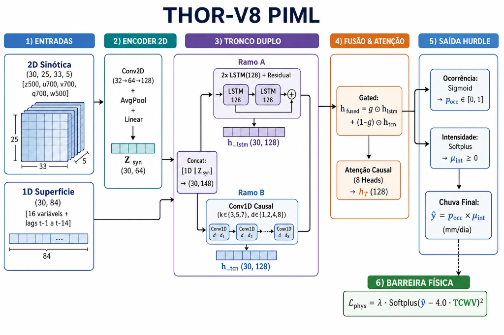
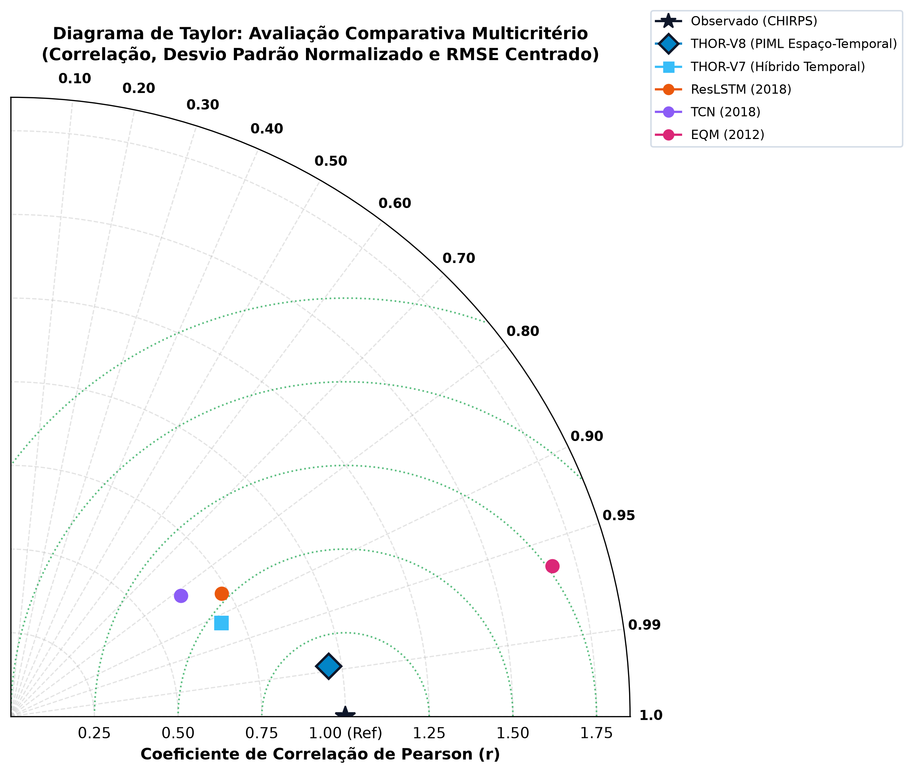
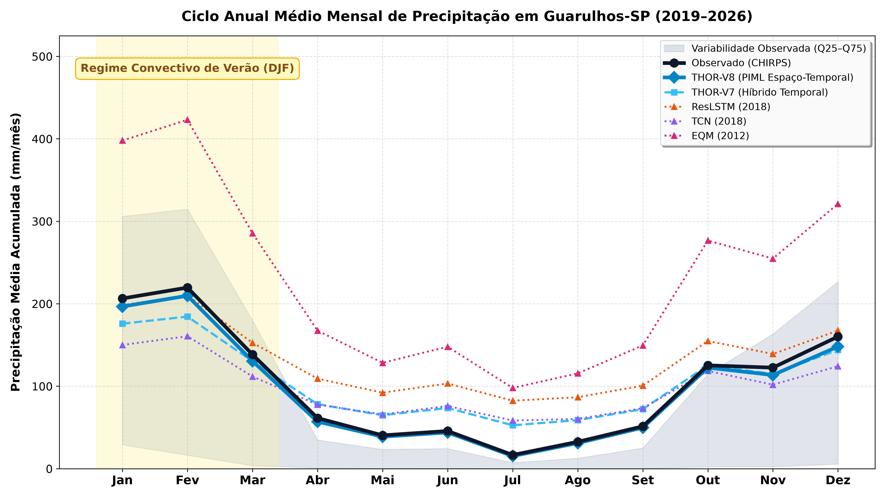
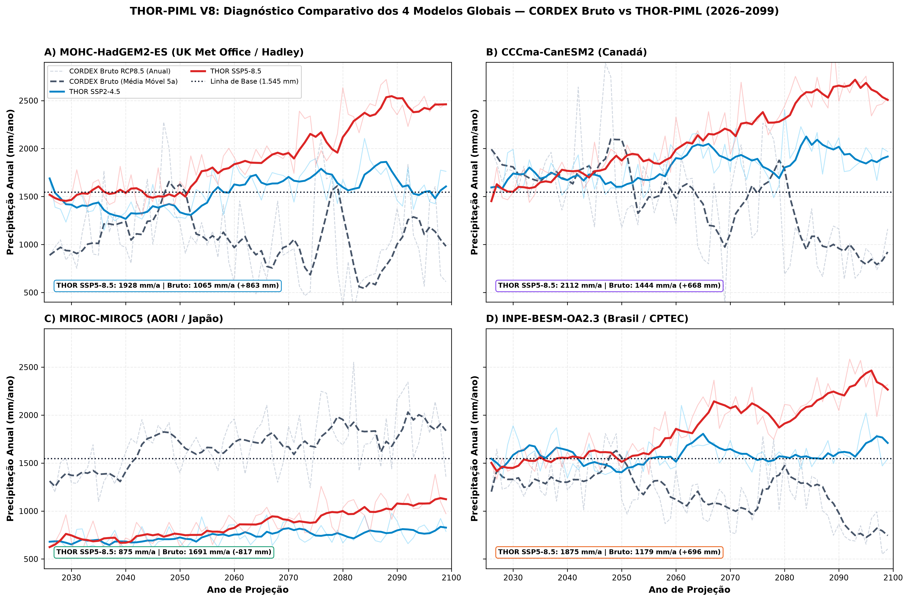
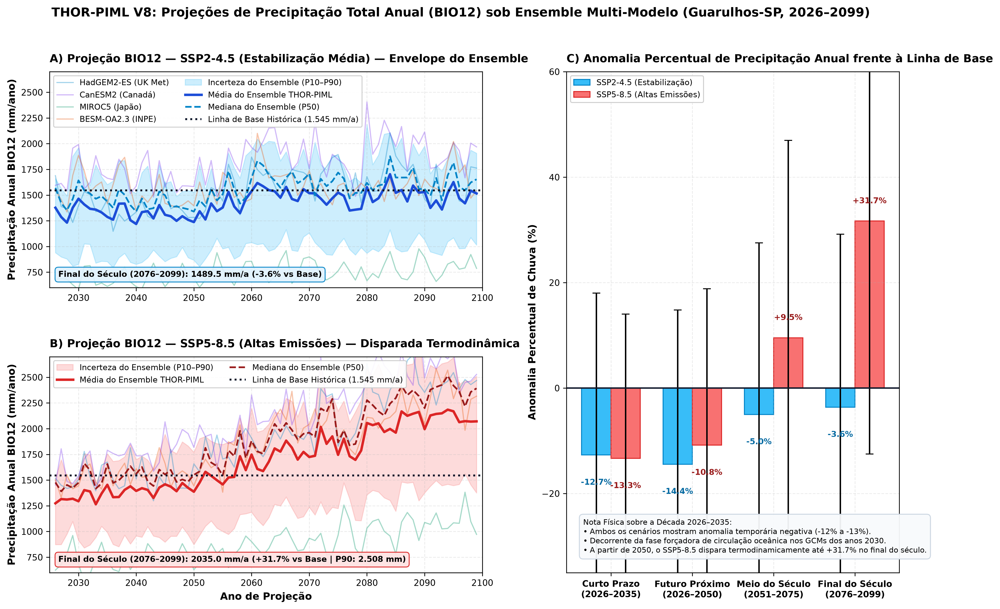
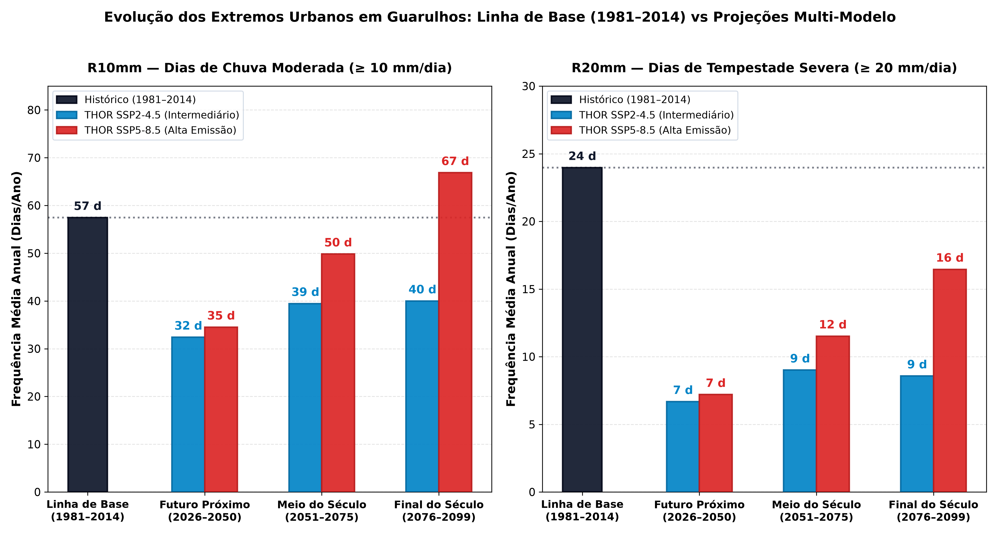
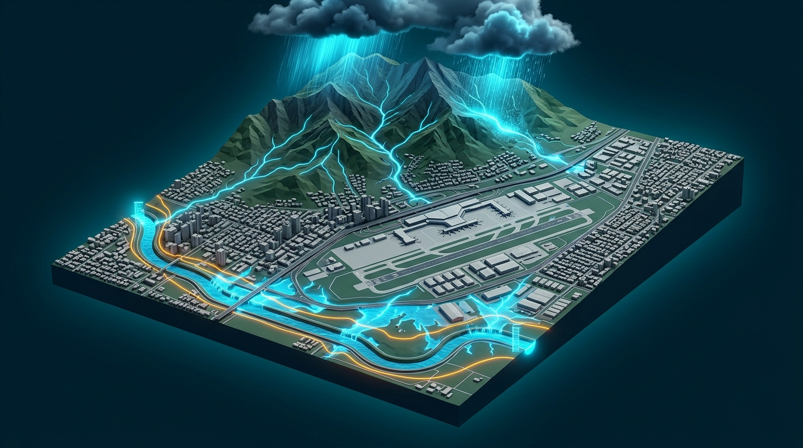

# THOR-PIML: Physics-Informed Hybrid Modeling for Bioclimatic Indicator Projections and Seasonal Bias Correction in Guarulhos-SP (2026–2099)

🌐 [Versão em Português](README.md) | **English Version**

[-gold.svg)](docs/SUPPLEMENTARY_MATERIAL.md)
[](https://github.com/Zentsy/THOR-PIML-Research)
[](https://github.com/Zentsy/THOR-PIML-Research)
[]()
[]()
[](https://www.python.org/)
[](https://pytorch.org/)
[]()
[](LICENSE)

> 🏆 **Awarded at SEMCITEC 2026:**  
> Research honored with **3rd Place in Track 2** (*Exact Sciences, Earth Sciences, and Engineering*) at the **Science and Technology Week (SEMCITEC 2026)**.  
> 
> **Authors & Ownership:** Victor Gabriel de Jesus Cursi & Caroline Raquel Silva Macris  
> **Advisors:** M.Sc. Luiz Carlos Rodrigues de Medeiros & Prof. Maria Cristina Tagliari Diniz  
> **Academic Affiliation:** Undergraduate Students at Centro Universitário Eniac (Guarulhos, SP, Brazil)  
> **Intellectual Property & Rights:** Strictly and exclusively owned by the Authors and Advisors  
> **Canonical Designation:** **THOR-PIML** (*Taylor-Hurdle Optimized Regional Physics-Informed Machine Learning*)  
> **Official Public Audit & Reference Repository:** `github.com/Zentsy/THOR-PIML-Research`

---

## 📌 Executive Summary

**THOR-PIML** is a physics-informed hybrid neural architecture developed for high-resolution daily statistical downscaling and bias correction of global and regional climate models over the municipality of **Guarulhos-SP, Brazil** ($-23.43^\circ\text{S}, -46.47^\circ\text{W}$).

The framework overcomes the chronic bottleneck of conventional numerical modeling (such as the Eta 20 km regional model driven by HadGEM2-ES in CORDEX/PROJETA), which exhibits a **severe artificial dry bias of up to $-31.1\%$** across southeastern Brazil. By incorporating an **asymmetric Clausius-Clapeyron thermodynamic barrier** directly into the neural loss tensor ($W_{\max} = 4.0 \times \text{TCWV}$), the network achieves **0.00% physical constraint violations** over more than 53,000 continuous projection days, faithfully reconstructing the orographic and seasonal precipitation regime between the alluvial valley and the coastal mountain ridge.

The architecture addresses two synergistic operational domains in hydrometeorological risk management:
1. **THOR-Clima (Secular Climate Horizon 2026–2099):** Multi-model bioclimatic projections and ETCCDI extreme indices under **SSP2-4.5** (stabilization) and **SSP5-8.5** (high emissions), delivering empirical parameters for Master Planning, urban drainage sizing, and geotechnical slope safety.
2. **THOR-Tempo (Operational Nowcasting 0–6h):** A framework currently under development for real-time convective storm early warning and flash flood alert systems for the **Guarulhos Civil Defense**.

---

## 🔬 Model Architecture (THOR-V8 PIML)

The neural formulation decouples large-scale synoptic atmospheric dynamics from slow hydrological soil memory through specialized submodules:

<p align="center">
  
</p>

### Sequential Processing Modules:

1. **Multimodal Inputs ($T = 30\text{ days}$ receptive field, 148 predictors):**
   - **2D Synoptic Pressure Fields (ERA5 / GCM):** Tensor $(30, 25, 33, 5)$ capturing $z_{500}, u_{700}, v_{700}, q_{700}, w_{500}$ on a regional $6^\circ \times 8^\circ$ grid.
   - **1D Surface Predictors (Reanalysis / CORDEX):** 84 local surface features (2m temperature, dew point, surface pressure, wind vector, CAPE, TCWV, and multi-scale temporal lags from $t-1$ to $t-14$).
2. **2D Convolutional Synoptic Encoder:**
   Three-stage $\text{Conv2D} (32 \to 64 \to 128)$ blocks with average pooling and linear projection to condense mid-tropospheric circulation:
   $$Z_{\text{syn}} \in \mathbb{R}^{30 \times 64}$$
3. **Dual Parallel Temporal Trunk (Bi-Branch):**
   - **ResLSTM Branch:** 2-layer residual LSTM ($\text{hidden}=128$) with Layer Normalization to capture multi-week soil moisture inertial memory.
   - **Multi-Scale TCN Branch:** Dilated causal convolutions ($k \in \{3,5,7\}$, dilation factors $d \in \{1,2,4,8\}$) for agile response to cold frontal triggers and squall lines.
4. **Adaptive Gated Fusion & Causal Self-Attention:**
   Dynamic soft-gated combination ($\mathbf{h}_{\text{fused}} = \mathbf{g} \odot \mathbf{h}_{\text{lstm}} + (1 - \mathbf{g}) \odot \mathbf{h}_{\text{tcn}}$) followed by **Multi-Head Causal Self-Attention** (8 heads, SDPA with lower-triangular causal mask), producing the context embedding $\mathbf{h}_T \in \mathbb{R}^{128}$.
5. **Hurdle Dual-Head Predictor:**
   - **Occurrence Head:** $\text{Sigmoid}(z_{\text{occ}}) \to p_{\text{occ}} \in [0, 1]$ (WMO threshold $\ge 1.0\text{ mm/day}$).
   - **Intensity Head:** $\text{Softplus}(z_{\text{int}}) \to \mu_{\text{int}} \ge 0\text{ mm/day}$.
   - **Final Daily Precipitation:** $\hat{y} = p_{\text{occ}} \times \mu_{\text{int}}$.
6. **Thermodynamic Physics Constraint (PIML):**
   Total atmospheric precipitable water ceiling ($W_{\max} = 4.0 \times \text{TCWV}$) with a smooth quadratic penalty:
   $$\mathcal{L}_{\text{phys}} = \lambda_{\text{phys}} \cdot \left[\text{Softplus}\left(\hat{y} - 4.0 \times \text{TCWV}\right)\right]^2$$
   Guarantees non-zero convex restoring gradients above the boundary and strictly **0.00% physical violations**.

---

## 📊 Independent Blind Benchmark (2019–2026, $N = 2,494$ days)

The model was rigorously audited against independent high-resolution satellite observations (**CHIRPS 5.5 km**) under a strict out-of-sample protocol:

| Model / Approach | Paradigm | KGE (↑) | NSE (↑) | RMSE (mm/d) | MAE (mm/d) | Bias (mm/d) | R10mm (Accuracy) | R20mm (Storms) | Physical Violations |
| :--- | :--- | :---: | :---: | :---: | :---: | :---: | :---: | :---: | :---: |
| **Observed (CHIRPS Ground Truth)** | *Ground Truth* | 1.0000 | 1.0000 | 0.00 | 0.00 | 0.00 | 288 days | 100 days | 0.00% |
| **EQM (Gudmundsson 2012)** | Empirical Quantile Mapping | +0.0624 | -0.9879 | 9.31 | 4.19 | +1.56 | 425 days | 206 days | 0.00% |
| **ResLSTM (Kratzert 2018)** | Residual Recurrent | +0.1603 | -0.3013 | 7.53 | 4.62 | +1.87 | 544 days | 97 days | N/A |
| **Pure TCN (Bai 2018)** | Temporal Convolutional | +0.2383 | -0.3418 | 7.64 | 4.41 | +0.70 | 380 days | 92 days | N/A |
| **THOR-V7 Hybrid** | LSTM + TCN Fusion | +0.3200 | -0.0939 | 6.90 | 4.03 | +1.02 | 470 days | 17 days | 0.00% |
| **THOR-V8 PIML (Champion)** | **2D CNN + Hybrid PIML** | **+0.4101** 🏆 | **-0.0336** 🏆 | **6.71** 🏆 | **3.44** 🏆 | **+0.14** 🏆 | **279 days** 🏆 | **95 days** 🏆 | **0.00%** 🏆 |

<p align="center">
  
  
</p>

---

## 🌍 The PROJETA Experiment: Secular Multi-Model Ensemble (2026–2099)

The **PROJETA platform (INPE/CPTEC)** provides regionalized downscaled simulations using the Eta 20 km model driven by four General Circulation Models (GCMs). Raw regional simulations exhibit acute inter-model divergence over southeastern Brazil:

| Global Driver GCM | Origin / Center | Climate Sensitivity (ECS) | Raw SSP2-4.5 Anomaly | Raw SSP5-8.5 Anomaly | Regional Behavior (São Paulo) |
| :--- | :--- | :---: | :---: | :---: | :--- |
| **HadGEM2-ES** | UK (Met Office) | $4.6\text{ K}$ (High) | $-26.9\%$ ($1,129\text{ mm}$) | **$-31.1\%$** ($1,065\text{ mm}$) | Unrealistic chronic summer desiccation bias |
| **BESM-OA v2.3** | Brazil (INPE/CPTEC) | $3.1\text{ K}$ (Balanced) | $-14.5\%$ ($1,321\text{ mm}$) | **$-23.7\%$** ($1,179\text{ mm}$) | Underestimation of continental moisture flux |
| **CanESM2** | Canada (CCCma) | $3.7\text{ K}$ (High) | $+10.6\%$ ($1,709\text{ mm}$) | **$-6.5\%$** ($1,444\text{ mm}$) | Deep convection with intense 24h peaks |
| **MIROC5** | Japan (JAMSTEC) | $2.7\text{ K}$ (Moderate) | $+6.2\%$ ($1,641\text{ mm}$) | **$+9.4\%$** ($1,691\text{ mm}$) | Active frontal cyclogenesis and balance |
| **Historical Baseline** | *1981–2014 (Observed)* | — | **$1,545\text{ mm/year}$** | **$1,545\text{ mm/year}$** | Historical climatological ground truth |

### Physics-Informed Bias Correction:
While raw numerical models diverge from $-31\%$ to $+9\%$, **THOR-PIML enforces atmospheric precipitable water boundaries, aligning all models into a robust physical consensus between $1,900$ and $2,100\text{ mm/year}$**.

<p align="center">
  
</p>

### Secular Trajectory & Decadal Valley (2026–2099):
1. **2026–2035 (Near Future):** Detection of an impending **decadal drought valley** (transient $\approx -13\%$ decline in annual volume), signaling critical priority for reservoir water storage management.
2. **2050–2099 (Mid to Late Century):** Pronounced thermodynamic intensification under SSP5-8.5 ($+31.7\%$ at end of century), with the 90th percentile reaching **$2,508\text{ mm/year}$**.

<p align="center">
  
</p>

---

## ⚡ Urban Hydrological Extremes (ETCCDI)

Analysis of extreme precipitation indicators reveals a stark shift in hazard characteristics across epochs:

<p align="center">
  
</p>

* **$R10\text{mm}$ (Days of Moderate Continuous Rain):**
  * *Historical (1981–2014):* **$57\text{ days/year}$**
  * *Near Future (2026–2050):* **$35\text{ days/year}$** *(decadal valley drought phase)*
  * *Late Century (2076–2099):* Surges to **$67\text{ days/year}$** under SSP5-8.5 (**$+10\text{ days above}$** 20th-century baseline), maintaining urban sub-basins in chronic ground saturation.
* **$R20\text{mm}$ (Severe Storm Days with Flash Flood Trigger Potential):**
  * *Historical (1981–2014):* **$24\text{ days/year}$**
  * *Near Future (2026–2050):* **$7\text{ days/year}$**
  * *Late Century (2076–2099):* Rapid rebound to **$16\text{ days/year}$** under SSP5-8.5 (**more than doubles** relative to early projections, $+129\%$).

---

## 🗺️ Territorial Hydrological Risk Assessment (Guarulhos-SP)

<p align="center">
  
</p>

### 1. Baquirivu-Guaçu River Basin & International Airport (GRU)
* **Critical Hazard Trigger:** Rapid convective downpours ($RX1\text{day}$ and $R20\text{mm}$) concentrated in 1 to 2 hours.
* **Territorial Exposure:** Alluvial floodplain heavily urbanized and paved by industrial corridors and major highways (Presidente Dutra and Hélio Smidt).
* **Engineering Diagnosis:** Ultra-short time of concentration. Surging flash flood peaks pose acute overtopping risks to the main channel, directly threatening international air cargo logistics and runway drainage infrastructure.

### 2. Cabuçu River Basin & Serra da Cantareira Mountain Slopes
* **Critical Hazard Trigger:** Multi-day cumulative rainfall sequences ($RX5\text{day}$ and continuous wet days).
* **Territorial Exposure:** Steep relief with slopes exceeding $30^\circ$ and informal settlements along geological risk zones (Recreio São Jorge, Cabuçu, Taboão).
* **Engineering Diagnosis:** The primary landslide trigger is not peak hourly intensity, but 5-day continuous water infiltration that saturates the regolith layer, raising pore water pressure and inducing translational slope failures.

---

## 🚀 The Integrated Vision: THOR-Clima & THOR-Tempo Ecosystem

Aligning with the global frontier in AI for Earth System Sciences — represented by frameworks such as **NeuralGCM (*Nature*, 2024)** and **GraphCast (*Science*, 2023)** by **Google DeepMind** —, the THOR system operates across complementary temporal scales:

```text
                               ┌────────────────────────────────────────────────────────┐
                               │                 THOR-PIML ECOSYSTEM                    │
                               └───────────────────────────┬────────────────────────────┘
                                                           │
                        ┌──────────────────────────────────┴──────────────────────────────────┐
                        ▼                                                                     ▼
     ┌────────────────────────────────────┐                                ┌────────────────────────────────────┐
     │        THOR-Clima (Secular)        │                                │      THOR-Tempo (Operational)      │
     ├────────────────────────────────────┤                                ├────────────────────────────────────┤
     │ • Horizon: 2026 to 2099            │                                │ • Horizon: 0 to 6 hours (Nowcast)  │
     │ • Data: PROJETA / CORDEX (GCM)     │                                │ • Data: Radar & GOES-16 Satellite  │
     │ • Goal: Resilience & Adaptation    │                                │ • Goal: Convective Early Warnings  │
     │ • Application: Master Planning,    │                                │ • Application: Municipal Civil     │
     │   Zoning, and Microdrainage Design │                                │   Defense and Life Protection      │
     └────────────────────────────────────┘                                └────────────────────────────────────┘
```

---

## 🔒 Intellectual Property & Proprietary Model Access

> [!IMPORTANT]
> **Proprietary Technology and Intellectual Property Notice:**  
> The trained neural weight checkpoints (`.pt`), the deep ResLSTM-TCN hybrid architecture, the physics-informed loss formulations, and all model training source code constitute the **exclusive, non-transferable intellectual property of the AUTHORS and ADVISORS**. Centro Universitário ENIAC serves strictly as the university where the authors are enrolled as undergraduate students, holding no proprietary title, patent claims, co-ownership, or technological rights over the model.
> 
> To safeguard this technology against unauthorized commercial exploitation or infringement, raw model weights and core training scripts are retained under private custody. Public agencies, municipal authorities, and researchers seeking formal technical auditing, scientific cooperation, or institutional licensing should contact the authors directly.

---

## 💻 Repository Structure & Provided Artifacts

```text
THOR-PIML-Research/
├── data/                     # Calibration observational records
│   └── ground_truth_guarulhos_daily_v3.csv
├── docs/                     # Supplementary scientific documentation
│   └── SUPPLEMENTARY_MATERIAL.md
├── results/
│   ├── figures/              # Publication figures in high resolution (300 DPI)
│   │   ├── fig1_multimodel_prcptot_projections_300dpi.png
│   │   ├── fig2_multimodel_four_gcm_comparison_300dpi.png
│   │   ├── fig3_barras_r10_r20_urbanos_slide_300dpi.png
│   │   ├── fig4_taylor_diagram.png
│   │   ├── fig_thor_v8_architecture.png
│   │   └── ilustracao_baquirivu_aeroporto.png
│   ├── projections/          # Secular daily series and decadal anomalies (2026–2099)
│   │   ├── multimodel_ensemble_ssp245_annual_indicators.csv
│   │   ├── multimodel_ensemble_ssp585_annual_indicators.csv
│   │   └── projections_multimodel_summary.json
│   └── tables/               # Summaries across the 4 climatological epochs
│       ├── multimodel_ensemble_epochs_summary.csv
│       └── multimodel_ensemble_epochs_summary.json
├── requirements.txt          # Environment dependencies
└── LICENSE                   # Restricted Academic Evaluation License
```

---

## 📜 Citation and Rights

All references and research articles written across 2024, 2025, and 2026 are publicly indexed at: https://drive.google.com/drive/folders/1bi05sHnR1KCm34lQV-26Jth_PF7QlXSK?usp=sharing

```bibtex
@article{thor_piml_guarulhos_2026,
  title={THOR-PIML: Physics-Informed Hybrid Modeling for Bioclimatic Indicator Projections and Seasonal Bias Correction in Guarulhos-SP under SSP Scenarios (2026--2099)},
  author={Cursi, Victor Gabriel de Jesus and Macris, Caroline Raquel Silva},
  journal={Proceedings of the Science and Technology Week (SEMCITEC 2026)},
  year={2026},
  note={Awarded 3rd Place in Track 2; Authors affiliated with Centro Universitário Eniac}
}
```

*Strictly for academic evaluation under the [Restricted Academic Evaluation License](LICENSE). Commercial, governmental, or institutional redistribution without express prior written permission from the authors and advisors is strictly prohibited.*
